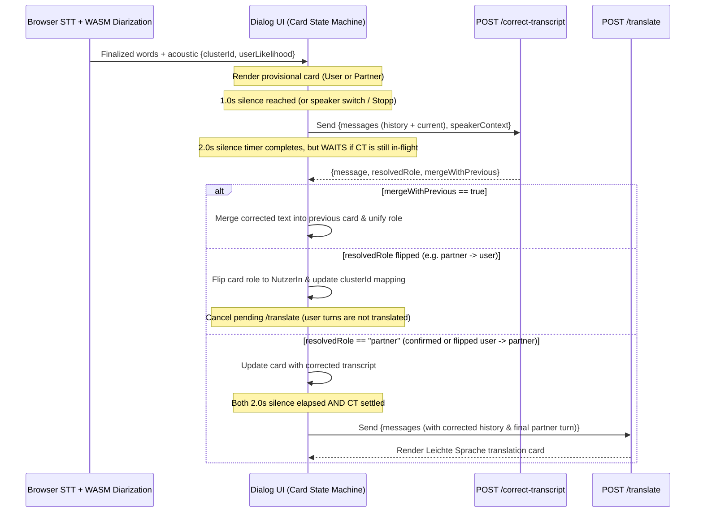

# PRD 4: Contextual Transcript Correction, Speaker Unification & Deferred Translation Timing

## 1. Overview & Problem Statement
Currently, `/correct-transcript` ([`src/api.rs`](../src/api.rs)) processes each spoken utterance in complete isolation (`{ role, message }`) without conversation history, and acoustic speaker diarization operates without semantic feedback from the language model. In live dialogs, this creates three issues:

1. **Context-Blind ASR Correction**:
   * Browser Speech-to-Text (Web Speech API) frequently misrecognizes domain-specific nouns (medications, medical procedures, government forms, street/person names) or short elliptical answers. Without knowing what question was just asked in the previous turn, `/correct-transcript` cannot reliably disambiguate homophones.
2. **Wrongly Split Turns & Misclassified Borderline Speakers**:
   * A single speaker who pauses mid-thought, or whose voice briefly dips into the uncertain acoustic similarity zone (`20%–65%` user likelihood), can be split into two consecutive cards assigned to different speakers (e.g., `Partner 1` followed by `NutzerIn`, or vice versa).
   * Conversely, in Begleit-App dialogs (doctor's office, Behörde, Beratung), semantic roles and turn-taking structure (Question → Answer alternation, institutional vs. client perspective) strongly constrain who is speaking and whether two fragments belong to a single turn.
3. **Race Between `/correct-transcript` (`1.0s`) and `/translate` (`2.0s`)**:
   * If `/translate` fires solely on a wall-clock `2.0s` timer without waiting for `/correct-transcript` and speaker unification to settle:
     * A `partner` card that `/correct-transcript` reclassifies as `user` would still trigger an unnecessary `/translate` call (translating the user's own words into *Leichte Sprache*).
     * A `user` card that `/correct-transcript` reclassifies as `partner` would miss its `/translate` call.
     * A split turn that gets unified (`mergeWithPrevious: true`) would translate only half of the sentence.

---

## 2. Architecture & Core Capabilities



---

### A. History-Aware `/correct-transcript`
Extend `POST /correct-transcript` so the LLM (`gemini-3.5-flash-lite`) receives the chronological conversation history alongside optional acoustic context for each turn:

1. **Contextual ASR Disambiguation**:
   * Prior turns (`user`, `partner`, `partner_simple`) provide topic and entity context so phonetic recognition errors in the latest turn are corrected accurately (e.g., Partner: *"Nehmen Sie Ibuprofen oder L-Thyroxin?"* → User raw STT: *"ich nehme l tür rock sin"* → Corrected: *"Ich nehme L-Thyroxin."*).
   * As before, the model **must not** invent new facts, answer questions, or simplify language—its text output remains a faithful transcript correction of the latest turn.
2. **Backward Compatibility**:
   * Existing callers sending the legacy single-message payload `{ "role": "partner", "message": "..." }` continue to work seamlessly (treated as a 1-turn conversation without acoustic metadata).

---

### B. Contextual Speaker Verification, Turn Merging & Cluster Unification
When acoustic metadata (`speakerContext`) is provided in the `/correct-transcript` request, the prompt instructs the model to evaluate both the corrected transcript and the speaker boundary:

1. **Inputs per Turn (`speakerContext`)**:
   * `clusterId`: Acoustic cluster ID from WASM diarization (e.g., `"cluster_0"`, `"cluster_1"`).
   * `userLikelihood`: Acoustic probability `[0.0, 1.0]` (or `0–100%`) that the voice belongs to `user`.
   * `pauseMs`: Silence gap in milliseconds between the end of the previous turn and the start of the current turn.
2. **Structured Resolution Outputs**:
   * `message`: The corrected transcript of the current turn (or the merged turn text if `mergeWithPrevious` is `true`, or just the corrected segment to append).
   * `resolvedRole` (`"user" | "partner"`):
     * **Acoustic Lock Guardrail**: If `userLikelihood >= 0.80` (strong user voice match) or `userLikelihood <= 0.10` (strong non-user voice match), the acoustic role is locked and not overridden by text semantics.
     * **Uncertain Zone Resolution (`0.10 < userLikelihood < 0.80`)**: When the acoustic score is borderline (such as the `~29%` opening turn), the LLM uses:
       * *Role Asymmetry*: Client/patient statements (*"Ich habe einen Termin"*, *"Mir tut der Rücken weh"*) vs. institutional/professional statements (*"Bitte nehmen Sie im Wartezimmer Platz"*, *"Unterschreiben Sie bitte hier"*).
       * *Conversational Turn-Taking*: If Turn $N-1$ asked a direct question, Turn $N$ answering that question belongs to the opposite speaker.
       * *Cluster Consistency*: Turns sharing the same `clusterId` should resolve to the same role unless an undetected fast speaker switch occurred inside the turn.
   * `mergeWithPrevious` (`boolean`):
     * Set to `true` when the current turn is a direct grammatical or semantic continuation of the immediately preceding turn by the **same speaker** (e.g., a sentence split across a breathing pause or a false speaker split like *"Warum kann er nur Sailor aber nicht"* + *"Sailors"*).
3. **Client-Side Acoustic Cluster Binding**:
   * When `/correct-transcript` resolves a borderline turn with `clusterId = "cluster_0"` to `"user"`, the frontend records the session binding `cluster_0 -> user` (unless contradicted by high-confidence acoustics).
   * Subsequent short, semantically neutral turns in `cluster_0` (e.g., *"Ja"*, *"Okay"*, *"Verstehe"*) immediately inherit `user` without needing semantic clues in the text itself.

---

### C. Coordinated Timing: `/translate` Waits for `/correct-transcript` & Speaker Resolution
The two-stage silence lifecycle in [`static/transcript_alignment.js`](../static/transcript_alignment.js) and [`templates/vad_diarization.html`](../templates/vad_diarization.html) is updated so `/translate` is strictly ordered after `/correct-transcript`:

| Stage | Trigger Condition | Action |
| :--- | :--- | :--- |
| **Stage 1: Correction & Speaker Resolution** | **`1.0s` silence** after last word of active turn (or immediate on speaker switch / `Stopp`) | Dispatch `POST /correct-transcript` with conversation history + `speakerContext`. Mark turn `correctionState = "in_flight"`. |
| **Continuation Window (`1.0s – 2.0s`)** | Same speaker resumes speaking before `2.0s` silence completes | Abort/supersede the in-flight `1.0s` `/correct-transcript` request, append the new words to the same card, and restart the `1.0s` and `2.0s` timers. |
| **Stage 2: Turn Lock & `/translate` Gate** | **Both** (a) **`2.0s` silence** has elapsed (or speaker switch / `Stopp` occurred) **AND** (b) `correctionState` has settled (`"done"` or `"failed"`) | 1. Apply `mergeWithPrevious` (if `true`, merge into prior card).<br>2. Apply `resolvedRole` (updating card header & `clusterId` role map).<br>3. **If final role is `partner`**: immediately fire `POST /translate` using the corrected & merged transcript.<br>4. **If final role is `user`**: do **not** call `/translate`. |

* **Graceful Fallback on `/correct-transcript` Error or Timeout**:
  * If `/correct-transcript` fails (network/5xx error) and the `2.0s` silence gate has already elapsed, the client retains the raw transcript and provisional acoustic role and immediately proceeds with `POST /translate` if the provisional role is `partner`.

---

## 3. Proposed API Schema Changes ([`src/api.rs`](../src/api.rs) & [`docs/diwop-api-contract.md`](../docs/diwop-api-contract.md))

### Request Payload (`POST /correct-transcript`)
Supports both the legacy single-turn body and the extended history-aware body (via an untagged enum or optional fields on the request struct):

```json
{
  "role": "partner",
  "message": "ich habe heute einen termin um vierzehn uhr bei frau doktor müller",
  "history": [
    {
      "role": "partner",
      "message": "Guten Tag, wie kann ich Ihnen helfen?",
      "clusterId": "cluster_1",
      "userLikelihood": 0.08
    }
  ],
  "speakerContext": {
    "clusterId": "cluster_0",
    "userLikelihood": 0.29,
    "pauseMs": 640
  }
}
```

### Response Payload (`POST /correct-transcript`)
```json
{
  "message": "Ich habe heute einen Termin um 14 Uhr bei Frau Dr. Müller.",
  "resolvedRole": "user",
  "mergeWithPrevious": false
}
```

* `resolvedRole` (`Option<Role>`, `"user"` | `"partner"`): Present when `speakerContext` or `history` is supplied; defaults to the request `role` when omitted.
* `mergeWithPrevious` (`Option<bool>`): `true` when the turn should be merged into the last turn in `history`.

---

## 4. Prompt Design ([`prompts/correct-transcript-system.md`](../prompts/correct-transcript-system.md) & [`prompts/correct-transcript.md`](../prompts/correct-transcript.md))
* Update the system and user prompts when `history` / `speakerContext` are present to:
  1. Format prior turns clearly as read-only context (`# Gesprächsverlauf`) so the model never repeats prior turns in `message`.
  2. Instruct the model to use `# Gesprächsverlauf` to resolve phonetically ambiguous words, names, and domain terms in `# Aktuelle Aussage`.
  3. Instruct the model to output structured fields (`resolvedRole`, `mergeWithPrevious`, and `message`) following the acoustic confidence guardrails (`userLikelihood >= 0.80` → keep `"user"`, `userLikelihood <= 0.10` → keep `"partner"`, `0.10 < userLikelihood < 0.80` → resolve using conversational context, role asymmetry, and `clusterId` consistency).

---

## 5. Implementation Steps
1. **Backend Schema & Prompt Extension (`src/api.rs`, `src/prompts.rs`, `prompts/correct-transcript*.md`)**:
   * Add optional `history` and `speaker_context` fields to the `/correct-transcript` request and `resolved_role` / `merge_with_previous` fields to [`CorrectTranscriptResponse`](../src/api.rs), preserving 100% backward compatibility with existing contract tests.
   * Update prompt construction and parser logic in [`src/prompts.rs`](../src/prompts.rs) with comprehensive unit tests.
2. **Deferred `/translate` Barrier in `TurnSilenceController` (`static/transcript_alignment.js`)**:
   * Update `TurnSilenceController` so the `2.0s` `onTranslateReady` callback waits if the `1.0s` `/correct-transcript` promise is still in-flight, and fires immediately once both the `2.0s` timer and the `/correct-transcript` response have settled.
3. **Frontend Speaker Reclassification & Turn Merge Handling (`templates/vad_diarization.html`)**:
   * Handle `mergeWithPrevious: true` by appending the corrected segment to the previous card, removing the split card, and re-triggering `/translate` on the unified card if its role is `partner`.
   * Handle `resolvedRole` changes (`partner -> user` or `user -> partner`) by updating the card's styling/badge, updating the session's `clusterId -> role` mapping, and either cancelling or triggering `/translate` accordingly.
4. **End-to-End & Unit Verification**:
   * Extend Rust integration tests (`tests/api_contract.rs`) and Node alignment tests (`test_transcript_alignment.mjs`) to verify history-aware correction, role flips (`partner -> user` cancelling `/translate`, `user -> partner` triggering `/translate`), and split-turn merging.
