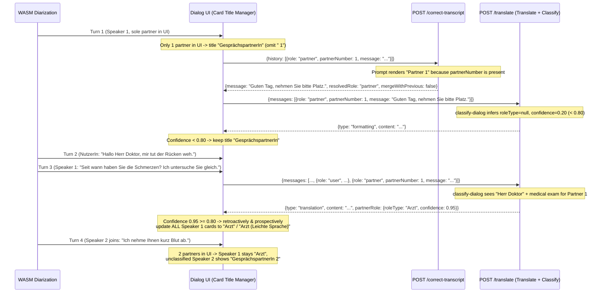

# PRD 5: Dynamic Partner Numbering & Contextual Partner Role Specification

## 1. Overview & Problem Statement

In live Begleit-App conversations (`/vad-diarization` and `/dialog-translation`), conversation partners are currently presented and transmitted with static, generic labels:

1. **Redundant `" 1"` Suffix in Single-Partner Dialogs**:
   * The vast majority of accompanied conversations involve `NutzerIn` and a single conversation partner. However, `/vad-diarization` ([`templates/vad_diarization.html`](../templates/vad_diarization.html)) unconditionally renders `"GesprächspartnerIn 1"` and `"GesprächspartnerIn 1 (Leichte Sprache)"` even when only one partner exists in the UI, adding unnecessary numbering noise.
2. **Partner Identity Lost Across Multi-Partner API Requests & Prompts**:
   * When multiple conversation partners participate in the same session (e.g., receptionist or nurse `Speaker 1` followed by physician `Speaker 2`), `POST /correct-transcript` and `POST /translate` ([`src/api.rs`](../src/api.rs)) serialize every non-user contribution solely as `"role": "partner"` and render `Partner:` in all prompts ([`src/prompts.rs`](../src/prompts.rs)). The language model cannot distinguish whether two `partner` turns in `# Historie` came from the same person or two different institutional actors.
3. **Generic Card Titles When Context Reveals the Partner's Actual Role**:
   * Even when the dialog context unambiguously identifies who the conversation partner is—for example via direct address (*"Hallo, Herr Doktor"*, *"Guten Tag, Frau Doktor"*) or domain-specific institutional actions (adjusting prescription dosage, processing a social-benefits application, taking a police report)—all cards continue to display `"GesprächspartnerIn"` rather than a concrete, easy-to-grasp title such as `"Arzt"`, `"Ärztin"`, `"ÄrztIn"`, or `"SachbearbeiterIn"`.

---

## 2. Architecture & End-to-End Flow



---

## 3. Core Capabilities & Detailed Specifications

### A. Dynamic Partner Numbering in the UI

Update card title formatting in [`templates/vad_diarization.html`](../templates/vad_diarization.html) (and [`static/transcript_alignment.js`](../static/transcript_alignment.js) helpers) so partner numbers are only shown when needed for disambiguation:

1. **Single Partner in UI -> Omit `" 1"`**:
   * Track the ordered set of distinct active partner `speakerId`s currently present in the dialog feed (`activePartnerSpeakers`, excluding `NutzerIn` and pending `null` speakers).
   * As long as `activePartnerSpeakers.length <= 1` and that speaker has no high-confidence `roleType`:
     * Raw transcript card title: **`GesprächspartnerIn`**
     * *Leichte Sprache* card title: **`GesprächspartnerIn (Leichte Sprache)`**
   * Because display ordinals (`1, 2, …`) are computed from `activePartnerSpeakers` (order of appearance among currently active partner speakers), even if an earlier provisional `"Speaker 1"` cluster was reclassified to `"NutzerIn"` (via PRD-3 `clusterRelabels` or PRD-4 `resolvedRole: "user"`), a remaining sole partner `"Speaker 2"` still displays **`GesprächspartnerIn`** (never `"GesprächspartnerIn 2"` when there is only one partner in the UI).
2. **Multiple Partners in UI (`>= 2`) -> Show Disambiguating Numbers**:
   * As soon as a second distinct partner speaker appears in the dialog feed (`activePartnerSpeakers.length >= 2`), reactive title refresh (`refreshAllPartnerCardTitles()`) updates all partner cards:
     * Any partner speaker without a high-confidence `roleType` displays **`GesprächspartnerIn <ordinal>`** (e.g., `GesprächspartnerIn 1`, `GesprächspartnerIn 2`) and **`GesprächspartnerIn <ordinal> (Leichte Sprache)`**.
     * If a temporary second partner card is merged into the preceding turn (`mergeWithPrevious: true`) or flipped to `NutzerIn` so `activePartnerSpeakers.length` returns to `1`, generic partner titles automatically revert to **`GesprächspartnerIn`**.
3. **Same-Role Multi-Partner Disambiguation**:
   * If two distinct active partner speakers both resolve to the **exact same** high-confidence `roleType` string (e.g., two officers both classified as `"PolizistIn"`), append their 1-based ordinal among matching-role partners (`"PolizistIn 1"`, `"PolizistIn 2"`). If their roles differ (e.g., `"Arzt"` and `"Medizinische Fachangestellte"`), omit numbers on both.

---

### B. Optional `partnerNumber` Wherever `"role"` Is `"partner"`

Extend all request message types where `"role"` can be `"partner"` with an optional 1-based `partnerNumber` (`u32`, `>= 1`), preserving 100% backward compatibility when omitted:

1. **Locations in [`src/api.rs`](../src/api.rs)**:
   * **`CorrectTranscriptRequest`** (legacy single-turn `POST /correct-transcript` payload):
     * `partner_number: Option<u32>` (`#[serde(default, rename = "partnerNumber", skip_serializing_if = "Option::is_none")]`)
   * **`CorrectTranscriptHistoryItem`** (contextual `history[]` items in `POST /correct-transcript`):
     * `partner_number: Option<u32>` (`#[serde(default, rename = "partnerNumber", skip_serializing_if = "Option::is_none")]`)
   * **`ConversationMessage`** (`messages[]` items in `POST /translate`):
     * `partner_number: Option<u32>` (`#[serde(default, rename = "partnerNumber", skip_serializing_if = "Option::is_none")]`)
2. **Validation Rules (`422 VALIDATION_ERROR`)**:
   * When `partnerNumber` is omitted (`None`), behavior is identical to today (e.g., `/dialog-translation` two-button mode or existing API clients).
   * When `partnerNumber` is present (`Some(n)`):
     * `n` **must** be `>= 1` (`partnerNumber: 0` returns `422 VALIDATION_ERROR`).
     * `role` **must** be `"partner"` (or `"partner_simple"` if echoed on a translated history item); sending `partnerNumber` on `role: "user"` returns `422 VALIDATION_ERROR`.
3. **Frontend Emission (`/vad-diarization`)**:
   * Extract the numeric partner ID from diarization `speakerId` (e.g., `"Speaker 1"` → `partnerNumber: 1`, `"Speaker 2"` → `partnerNumber: 2`) and include `partnerNumber` on every `role: "partner"` item built by `buildCorrectTranscriptHistory` and `buildTranslateHistoryMessages`—even when there is only one partner in the UI—so the LLM immediately has consistent `Partner 1` history if a `Partner 2` joins later.
   * If `/correct-transcript` flips a turn from `partner` to `user` (`resolvedRole: "user"`), clear `partnerNumber` on that turn's stored history entry.

---

### C. Partner Numbers in Prompts (When Present)

Update prompt builders in [`src/prompts.rs`](../src/prompts.rs) and templates in [`prompts/`](../prompts/) to include partner numbers whenever `partnerNumber` is `Some(n)` and omit them cleanly when `None`:

1. **History Formatting Rule (Shared Logic)**:
   * `Role::User` → `User`
   * `Role::Partner`:
     * `partner_number == Some(n)` → `Partner {n}`
     * `partner_number == None` → `Partner`
   * `Role::PartnerSimple`:
     * Uses `entry.partner_number` if set, otherwise inherits `partner_number` from the immediately preceding `Role::Partner` entry in the history slice:
     * `Some(n)` → `Partner {n} (Leichte Sprache)` (or `Partner {n} (leichte Sprache)` in `classify-dialog`)
     * `None` → `Partner (Leichte Sprache)`
2. **Per-Prompt Integration**:
   * **`POST /correct-transcript`** ([`prompts/correct-transcript.md`](../prompts/correct-transcript.md), [`prompts/correct-transcript-system.md`](../prompts/correct-transcript-system.md)):
     * `# Gesprächsverlauf` renders `Partner 1 [clusterId=..., userLikelihood=0.06]: ...` and `Partner 1 (Leichte Sprache): ...` when `partnerNumber` is present.
     * `# Aktuelle Aussage` renders `- Vorläufige Rolle: partner (Partner 1)` when `target.role == Role::Partner` and `target.partner_number == Some(1)` (while keeping the JSON output enum `resolvedRole` strictly `"user" | "partner"`).
     * Note in `correct-transcript-system.md` that numbered partners (`Partner 1`, `Partner 2`) represent distinct provisional acoustic speaker clusters in multi-party conversations.
   * **`POST /translate` — Translation Step** ([`prompts/translate.md`](../prompts/translate.md), [`prompts/translate-dynamic-few-shots.md`](../prompts/translate-dynamic-few-shots.md)):
     * `%HISTORY%` renders `Partner 1: ...`, `Partner 2: ...`, and `Partner 1 (Leichte Sprache): ...` when `partnerNumber` is present.
     * When `last_message.partner_number` is `Some(n)`, label the target `input` block with `Partner {n}:` so the translation model knows which partner is speaking relative to `%HISTORY%`.
   * **`POST /translate` — Classification Step** ([`prompts/classify-dialog.md`](../prompts/classify-dialog.md), [`prompts/classify-dialog-system.md`](../prompts/classify-dialog-system.md)):
     * `%HISTORY%` renders numbered partners when present.
     * Replace static `Partner:` and `Partner (leichte Sprache):` in `prompts/classify-dialog.md` with `%PARTNER_LABEL%:` (`Partner {n}` when `Some(n)`, `Partner` when `None`) and `%PARTNER_SIMPLE_LABEL%:` (`Partner {n} (leichte Sprache)` when `Some(n)`, `Partner (leichte Sprache)` when `None`).

---

### D. Contextual Partner Role Inference in `classify-dialog` (`roleType` + `confidence`)

Extend the post-translation classification step (`classify-dialog`, which already runs at `"low"` reasoning with structured JSON Schema on every `POST /translate` call) to infer who the speaking partner in `# Aussage` actually is:

1. **Inference Scope & Multi-Partner Precision**:
   * Infer the role specifically for the conversation partner who authored `# Aussage` (e.g., `Partner 2` if `# Aussage` is labeled `Partner 2:`), using `# Aussage` together with turns spoken by or addressed to that same partner in `# Historie`.
2. **Naming, Grammatical Gender & Inclusive Binnen-I Rules**:
   * `roleType` must be a concise, respectful German role, profession, or relationship noun suitable as a UI card header (`1–35` characters, plain text, no Markdown):
     * **Explicit masculine cue** in context (e.g., addressed as *"Herr Doktor"*, *"Danke, Herr Pfleger"*, *"Ich bin Ihr Sachbearbeiter"*): use the masculine form, e.g., `"Arzt"`, `"Sachbearbeiter"`, `"Apotheker"`, `"Polizist"`, `"Berater"`, `"Verkäufer"`, `"Lehrer"`, `"Pfleger"`.
     * **Explicit feminine cue** in context (e.g., addressed as *"Hallo, Frau Doktor"*, *"Ich bin Ihre Ärztin"*): use the feminine form, e.g., `"Ärztin"`, `"Sachbearbeiterin"`, `"Apothekerin"`, `"Polizistin"`, `"Beraterin"`, `"Verkäuferin"`, `"Lehrerin"`, `"Pflegerin"`.
     * **Clear role without explicit gender cue** (e.g., partner adjusts blood-pressure medication dosage or processes a permit application without being addressed as *Herr*/*Frau*): use the Begleit-App's inclusive Binnen-I convention (consistent with `"NutzerIn"` and `"GesprächspartnerIn"`) or an inherently gender-neutral role noun, e.g., `"ÄrztIn"`, `"SachbearbeiterIn"`, `"ApothekerIn"`, `"PolizistIn"`, `"BeraterIn"`, `"VerkäuferIn"`, `"Pflegekraft"`, `"Praxis-Team"`, `"Rettungsdienst"`.
   * **Privacy & Placeholder Guardrails**:
     * **Never** include personal names or titles with surnames in `roleType` (e.g., output `"Arzt"`, **never** `"Dr. Müller"` or `"Herr Schmidt"`).
     * **Never** output generic fallback labels (`"GesprächspartnerIn"`, `"Partner"`, `"Person"`, `"Unbekannt"`). When context is insufficient to determine a specific role, output `"roleType": null` and `"confidence": 0.0`.
3. **Confidence Calibration Rubric (`0.0 – 1.0`)**:
   * **`0.85 – 1.00` (High — Explicit or Unambiguous Role)**: Direct form of address/self-introduction (*"Herr Doktor"*, *"Hier spricht die Polizei"*, *"Als Ihre Sachbearbeiterin beim Sozialamt..."*) or unmistakable role-exclusive actions (*"Ich habe Ihre Blutdruckwerte angeschaut. Wir müssen Ihre Medikamente anpassen und die Dosis erhöhen."* → `"ÄrztIn"` / `"Ärztin"` at `>= 0.85`).
   * **`0.50 – 0.84` (Medium — Plausible Hypothesis, Not Yet Certain)**: Situational clues that narrow the setting without uniquely fixing the speaker's role (*"Nehmen Sie bitte kurz im Wartezimmer Platz"* → `"Praxis-Team"` or `"SachbearbeiterIn"` at `~0.60`).
   * **`0.00 – 0.49` (Low — Insufficient Evidence)**: Generic greetings, small talk, or short acknowledgments (*"Guten Tag, wie geht es Ihnen?"*) → `"roleType": null`, `"confidence": 0.0`.
4. **Rust Post-Processing Guardrails**:
   * Trim `roleType`; if empty, `> 40` characters, or equal (case-insensitively) to a generic placeholder (`"gesprächspartnerin"`, `"gesprächspartner"`, `"partner"`, `"unbekannt"`, `"other"`), normalize to `None`.
   * Clamp `confidence` to `[0.0, 1.0]`. When `roleType` is `None` (or `confidence <= 0.0`), omit `partnerRole` (`None`) on `TranslationResponse`.

---

### E. High-Confidence Card Title Promotion in the UI

When `POST /translate` returns `partnerRole: { roleType, confidence }`:

1. **High-Confidence Threshold (`HIGH_ROLE_CONFIDENCE_THRESHOLD = 0.80`)**:
   * If `partnerRole.confidence >= 0.80` and `partnerRole.roleType` is non-empty:
     * Associate `{ roleType, confidence }` with that partner speaker (`speakerId` in `/vad-diarization`, or the single `partner` role in `/dialog-translation`).
     * Immediately update the title on **all** existing cards of that speaker—both original transcript cards (`"<roleType>"`) and *Leichte Sprache* cards (`"<roleType> (Leichte Sprache)"`)—and use `"<roleType>"` immediately on all future cards of that speaker as soon as they appear.
2. **Sticky Retention & Refinement Across the 5-Turn History Window**:
   * Because `/translate` and `classify-dialog` cap `%HISTORY%` to the last 5 `user`/`partner` turns, a late farewell turn (e.g., Turn 12: *"Vielen Dank, bis nächste Woche!"*) may no longer contain the Turn 2 *"Hallo Herr Doktor"* cue and may return `partnerRole: undefined` or low confidence.
   * Once a speaker has an established high-confidence `roleType` (`>= 0.80`), **retain** it across subsequent low-confidence turns for the remainder of the dialog session (`Neuer Dialog` resets all session roles).
   * Allow **refinement** when a later turn returns a new high-confidence `partnerRole` (`newConfidence >= 0.80` and `newConfidence >= currentConfidence - 0.05`)—for example upgrading gender-unspecified `"ÄrztIn"` (`0.85`) on Turn 1 to `"Arzt"` (`0.95`) on Turn 3 once the user says *"Danke, Herr Doktor"*.
3. **Admin Debug Visibility (`Klassifizierung` Panel)**:
   * Include `partnerRole` in `ClassificationDebugInfo` so admin users see a pill badge (e.g., `Rolle: Ärztin (94 %)` or `Rolle: Praxis-Team (60 %)`) in the `Klassifizierung` summary row even when `confidence < 0.80`.

---

## 4. Proposed API & Schema Changes

### 1. `POST /correct-transcript` Request (`src/api.rs` & `docs/diwop-api-contract.md`)

Legacy single-turn request (optional `partnerNumber`):
```json
{
  "role": "partner",
  "partnerNumber": 1,
  "message": "sie müssen den antrag bis ende nächste woche abgeben"
}
```

Contextual `history` request (optional `partnerNumber` on `partner` items):
```json
{
  "history": [
    {
      "role": "partner",
      "partnerNumber": 1,
      "message": "Guten Tag, ich messe kurz Ihren Blutdruck, bevor Herr Doktor Weber kommt.",
      "clusterId": "cluster_1",
      "userLikelihood": 0.05
    },
    {
      "role": "partner_simple",
      "message": "Guten Tag.  \nIch messe kurz Ihren Blut-Druck.  \nDanach kommt Herr Doktor Weber."
    },
    {
      "role": "partner",
      "partnerNumber": 2,
      "message": "guten tag kommen sie bitte ins sprechzimmer",
      "clusterId": "cluster_2",
      "userLikelihood": 0.04,
      "pauseMs": 1400
    }
  ]
}
```

### 2. `POST /translate` Request & Response (`src/api.rs` & `docs/diwop-api-contract.md`)

Request (`optional partnerNumber` on `ConversationMessage`):
```json
{
  "messages": [
    {
      "role": "user",
      "message": "Hallo Herr Doktor, wann muss ich das Medikament nehmen?"
    },
    {
      "role": "partner",
      "partnerNumber": 1,
      "message": "Bitte nehmen Sie eine Tablette jeden Morgen vor dem Frühstück."
    }
  ]
}
```

Response (`optional partnerRole` on `TranslationResponse`, omitted when unknown):
```json
{
  "type": "translation",
  "content": "Nehmen Sie **jeden Morgen 1 Tablette**.  \nNehmen Sie die Tablette **vor dem Frühstück**.",
  "partnerRole": {
    "roleType": "Arzt",
    "confidence": 0.95
  }
}
```

| Field | Type | Required | Meaning |
| --- | --- | --- | --- |
| `messages[].partnerNumber` | `integer` (`>= 1`) | No | Optional 1-based identifier of the conversation partner when `role` is `"partner"` (or `"partner_simple"`) |
| `partnerRole` | `PartnerRole` | No | Optional inferred real-world role of the last speaking partner; omitted when unknown (`roleType` is `null`) |
| `partnerRole.roleType` | `string` | If `partnerRole` present | Concise German role title suitable as a card header (e.g., `"Arzt"`, `"Ärztin"`, `"ÄrztIn"`, `"SachbearbeiterIn"`) |
| `partnerRole.confidence` | `number` (`0.0–1.0`) | If `partnerRole` present | Model confidence in `roleType`; clients promote `roleType` to the speaker's card title when high (`>= 0.80`) |

### 3. `prompts/classify-dialog-schema.json` Addition

Add `$defs.partnerRole` and require `"partnerRole"` on each `oneOf` classification object:
```json
"partnerRole": {
  "type": "object",
  "required": ["roleType", "confidence"],
  "additionalProperties": false,
  "properties": {
    "roleType": {
      "type": ["string", "null"]
    },
    "confidence": {
      "type": "number",
      "minimum": 0.0,
      "maximum": 1.0
    }
  }
}
```

Update [`prompts/classify-dialog-few-shots.md`](../prompts/classify-dialog-few-shots.md):
* **Ausgabe 1** (*"Hallo, Frau Doktor"* + blood-pressure medication adjustment):
  `{"type": "pass", "category": "ok", "topic": "medical", "partnerRole": {"roleType": "Ärztin", "confidence": 0.96}}`
* **Ausgabe 2** (casual acquaintance Tierpark/coffee chat turning into hate speech):
  `{"type": "danger", "category": "hate-speech", "topic": "social", "partnerRole": {"roleType": "Bekannter", "confidence": 0.60}}`

---

## 5. Implementation Steps

1. **API Types, Validation & Contract Docs (`src/api.rs`, `src/lib.rs`, `docs/diwop-api-contract.md`)**:
   * Add optional `partner_number: Option<u32>` to `ConversationMessage`, `CorrectTranscriptHistoryItem`, and `CorrectTranscriptRequest` with `>= 1` and role validation (`422 VALIDATION_ERROR` on `0` or `role: "user"`).
   * Add `PartnerRole { role_type: String, confidence: f32 }` and optional `partner_role: Option<PartnerRole>` to `TranslationResponse` and `ClassificationDebugInfo`, registering `PartnerRole` in `ApiDoc` OpenAPI schemas.
2. **Prompts, Classification Schema & Guardrails (`prompts/classify-dialog*.md`, `prompts/translate*.md`, `prompts/correct-transcript*.md`, `src/prompts.rs`)**:
   * Update `format_correct_transcript_history`, `build_correct_transcript_contextual_prompt`, `format_translate_history`, `build_translate_prompt_with_few_shots`, and `build_classify_dialog_prompt` to render `Partner {n}` when `partnerNumber` is present and `Partner` when omitted.
   * Extend `prompts/classify-dialog-schema.json`, `prompts/classify-dialog-system.md`, `prompts/classify-dialog.md`, and `prompts/classify-dialog-few-shots.md` with `partnerRole` (`roleType` + `confidence`) instructions and normalization in `src/prompts.rs` (plus `EchoPromptRunner` default `{"roleType": null, "confidence": 0.0}`).
3. **Frontend Dynamic Partner Numbering & Role Title Promotion (`static/transcript_alignment.js`, `templates/vad_diarization.html`, `templates/dialog_translation.html`)**:
   * Extract `partnerNumber` from diarized `speakerId`s and pass `partnerNumber` on `role: "partner"` entries in `buildCorrectTranscriptHistory` and `buildTranslateHistoryMessages`.
   * Implement dynamic partner title resolution (`"GesprächspartnerIn"` when `<= 1` active partner in UI; `"GesprächspartnerIn 1"`, `"GesprächspartnerIn 2"`, … when `>= 2` active partners; high-confidence `roleType` promotion `>= 0.80` across all raw and *Leichte Sprache* cards of that speaker with sticky retention and same-role disambiguation).
   * Render `Rolle: <roleType> (<pct> %)` badge in the admin `Klassifizierung` debug summary in both `/vad-diarization` and `/dialog-translation`.
4. **Automated Tests**:
   * **Rust Unit & Integration Tests (`src/prompts.rs`, `src/api.rs`, `tests/api_test.rs`)**: Verify optional `partnerNumber` validation, numbered vs. unnumbered prompt rendering across `/correct-transcript`, `/translate`, and `classify-dialog`, and `partnerRole` serialization/omission on `POST /translate`.
   * **Node Alignment & Title Tests (`test_transcript_alignment.mjs`)**: Verify `partnerNumber` propagation in history builders, single-partner `" 1"` omission, multi-partner numbering activation, and retroactive/prospective `roleType` title updates.
