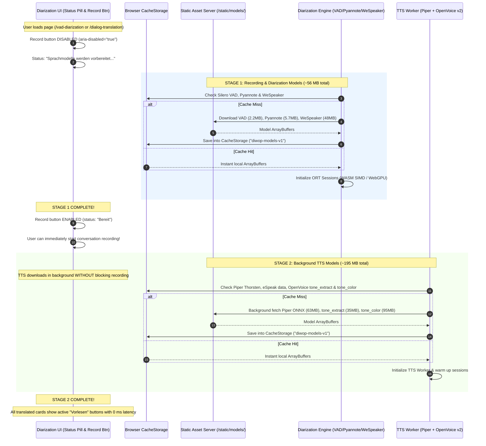

# PRD 6: On-Device Voice-Matched Text-to-Speech Playback on Translated *Leichte Sprache* Cards

## 1. Overview & Problem Statement

Begleit-App supports people with cognitive or reading impairments during real-world institutional and everyday conversations (medical appointments, public authorities, pharmacies, social services) by translating partner statements into German *Leichte Sprache*. While visual *Leichte Sprache* cards significantly lower reading barriers, many target users process spoken language faster and with less cognitive fatigue than written text—especially during live face-to-face conversations.

Adding an on-device **Play ("Vorlesen") button** to every translated/formatted *Leichte Sprache* card solves three concrete user-experience gaps:

1. **Multimodal Accessibility for *Leichte Sprache* Users**:
   * Users with reading difficulties, visual impairments, or acute situational stress can tap a single button on any *Leichte Sprache* card to hear the simplified statement read aloud at a calm, clear pace.
2. **Speaker Attribution via Partner Voice Similarity (Not Deepfake Prosody)**:
   * If every card is read by a single generic synthetic voice, users lose acoustic cues about *who* spoke—especially in multi-partner appointments (e.g., `"Praxis-Team"` vs. `"Arzt"`, or male vs. female speakers).
   * **Accessibility Principle — Timbre Similarity Without Hectic Prosody Cloning**: Perfect voice cloning is neither required nor desirable if it copies a conversation partner's fast speaking rate, mumbling, or stressed cadence. Instead, synthesis must preserve **recognizable vocal similarity** (pitch register, vocal timbre, warmth, and gender characteristics) while enforcing **calm, well-articulated German *Leichte Sprache* pacing** with clear pauses at line breaks.
3. **100% On-Device Execution, Complete Privacy & Offline Capability**:
   * Conversation partners in doctor's offices or government agencies have not signed third-party SaaS biometric voice-replication waivers. Under GDPR (Art. 9) and German confidentiality law (§ 201 StGB), partner reference audio must **never leave the client device**.
   * Running Piper TTS and OpenVoice v2 directly on the client device via `onnxruntime-web` eliminates server audio compute costs and enables future mobile apps to read cards aloud completely offline.

---

## 2. Staged Download & Lifecycle Architecture

To ensure live recording is never delayed by speech synthesis assets, model downloads are strictly partitioned into two consecutive phases:

---

## 3. Model Stack & Resource Specification

### Stage 1: Upfront Models for Recording & Diarization (Blocking)
*Must be loaded before the user can tap "Aufnahme":*

| Model / Asset | Size | Role | Execution Provider |
| :--- | :--- | :--- | :--- |
| `silero_vad_v5.onnx` | **2.2 MB** | 32 ms chunk voice activity detection | WASM SIMD |
| `pyannote_segmentation_3_0.onnx` | **5.7 MB** | 10 s sliding window speaker segmentation | WASM SIMD |
| `wespeaker_voxblink2_samresnet100_LM.int8.onnx` | **48.0 MB** | 256-D speaker embedding extraction | WASM SIMD / WebGPU |
| `vad_diarization_wasm_bg.wasm` | **0.6 MB** | Rust clustering & audio pipeline logic | WASM |
| `ort-wasm-simd-threaded.jsep.wasm` | **~28 MB** | ONNX Runtime engine (cached) | WASM / WebGPU |
| **Stage 1 Total** | **~56 MB** models (~84 MB with runtime) | **Unlocks Recording** |

---

### Stage 2: Background Models for On-Device TTS (Non-blocking)
*Downloads automatically in the background right after Stage 1 is ready:*

| Model / Asset | Size | Role | Execution Provider |
| :--- | :--- | :--- | :--- |
| `de_DE-thorsten-medium.onnx` | **~63 MB** | Piper VITS German base voice (22.05 kHz) | WASM SIMD / WebGPU |
| Piper eSpeak WebAssembly / JSON dict | **~3 MB** | Text → German IPA phonemes in browser | WASM |
| `openvoice_v2_tone_extract.onnx` | **~35 MB** | 256-D partner tone embedding from 16kHz/22kHz clip | WASM SIMD |
| `openvoice_v2_tone_color.onnx` | **~95 MB** | Timbre converter (matches Piper to partner) | WASM SIMD / WebGPU |
| **Stage 2 Total** | **~196 MB** | **Unlocks Voice Playback** |

---

## 4. Client-Side Components & Features

### A. Client Model Cache (`static/model_cache.js`)
* Uses browser `CacheStorage` (`diwop-model-cache-v1`) to persist downloaded model ArrayBuffers permanently.
* Subsequent page visits retrieve models from disk cache in `< 50 ms` with zero network traffic.

### B. Dedicated Web Worker for TTS (`static/tts_worker.js`)
* Runs all TTS inference off the main UI thread to guarantee zero frame drops or audio stuttering during live recording.
* Normalizes *Leichte Sprache* Markdown (strips formatting, smooths compound hyphens like `Kranken-Versicherung` → `Krankenversicherung`).
* Generates Piper base speech and runs OpenVoice v2 tone color conversion when partner reference audio is available ($\ge 1.5\text{ s}$).

### C. Play Button UI & Acoustic Feedback-Loop Echo Guard
* **Placement**: Every finalized *Leichte Sprache* card displays a dedicated `.card-tts-play-btn` ("Vorlesen" / "Stopp").
* **Single-Playback Exclusivity & Caching**: Audio is synthesized once per card and cached in memory for instant 0 ms replay. Starting playback on any card stops any previous playback.
* **Echo Guard**: While TTS audio is playing through device loudspeakers, VAD and Speech Recognition turn ingestion is paused (+ `400 ms` acoustic tail) to prevent feedback loops.
